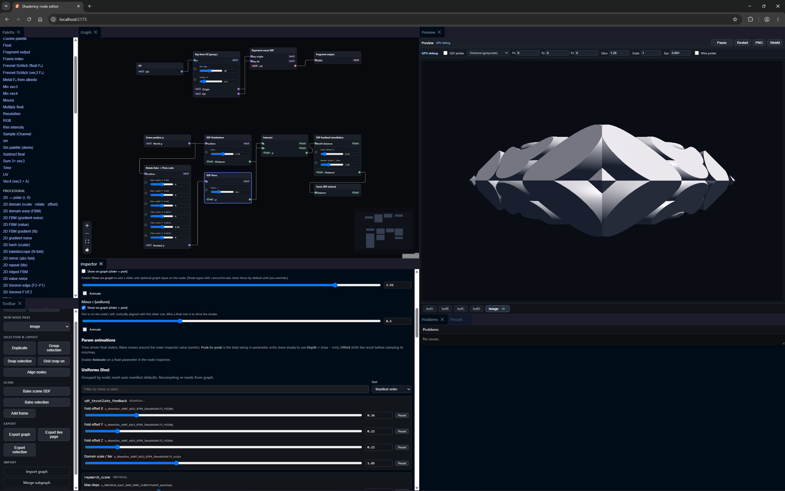

# shadertoy-nodeeditor

A nodegraph editor for building **Shadertoy-style fragment shaders** (graph → GLSL), with a live preview runner. Includes an SDF/raymarching toolkit, multipass buffers, media inputs, and "bake selection" to collapse any subgraph into a custom GLSL node.

> **Status: early / pre-release.** APIs and graph JSON may change. Some SDF presets are still rough. The project is heading toward code-first SDF authoring and mesh baking (see `TODO.md`).



## Quickstart

```bash
npm install
npm run dev
```

- **Dev server**: `npm run dev` (runs the editor workspace)
- **Build**: `npm run build`
- **Type check**: `npm run check`
- **Tests**: `npm run test` (compiler, runner, editor)

Requires Node 22+.

## Repo map

- **Editor UI**: `apps/editor/` (SvelteKit + Vite)
- **Compiler (graph → GLSL)**: `packages/compiler/`
- **Runner (preview execution)**: `packages/runner/`

## Documentation

- **Getting started**: `docs/getting-started.md`
- **Architecture overview**: `docs/architecture.md`
- **Shader pipeline** (passes, `iChannels`, **media textures**, **audio uniforms**): `docs/shader-pipeline.md`
- **Compiler deep dive**: `packages/compiler/ARCHITECTURE.md`
- **Contributing (presets)**: `CONTRIBUTING.md`
- **Backlog / roadmap**: `TODO.md`

## References

- Inigo Quilez shader articles: `https://iquilezles.org/articles/`

## License

[MIT](LICENSE)
